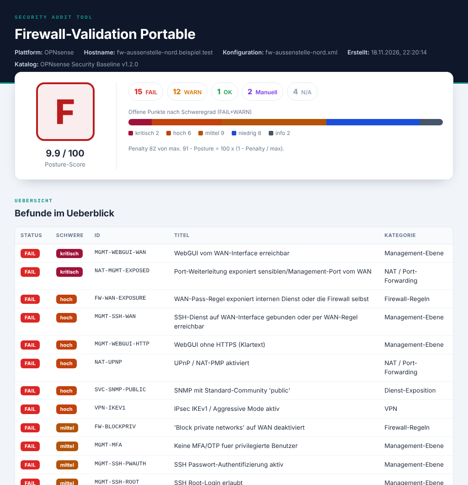
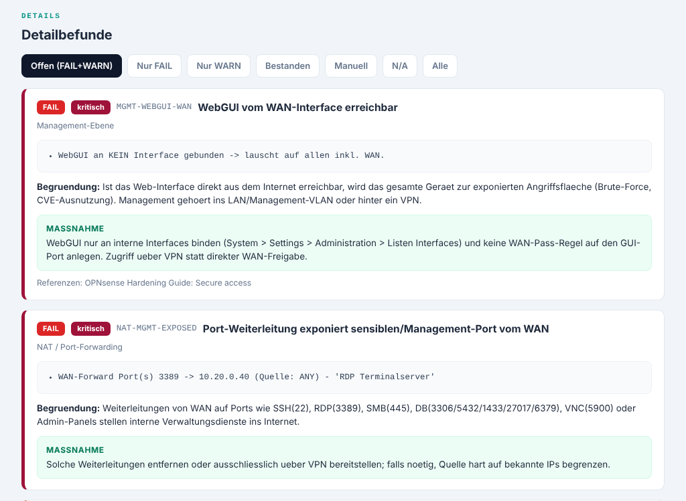
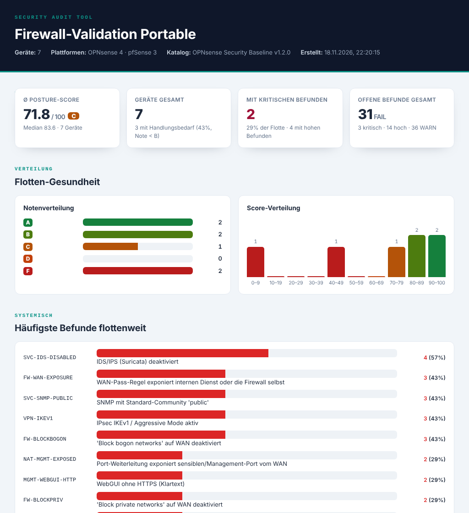
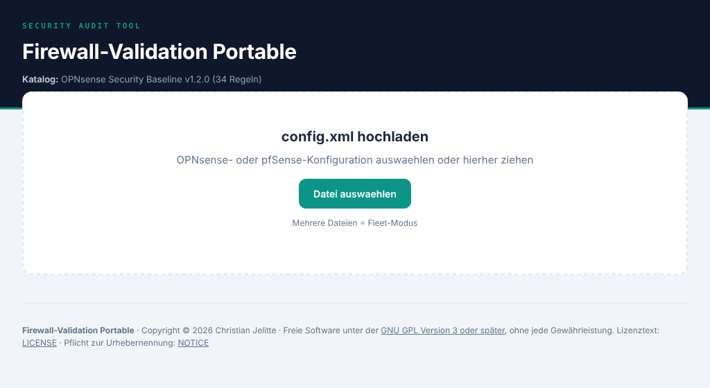
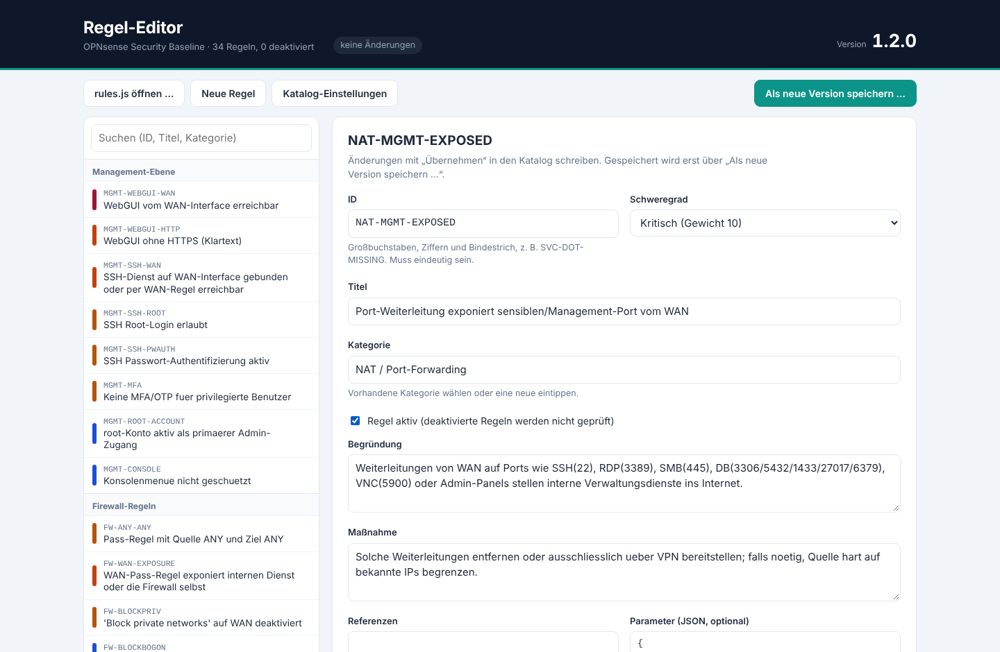
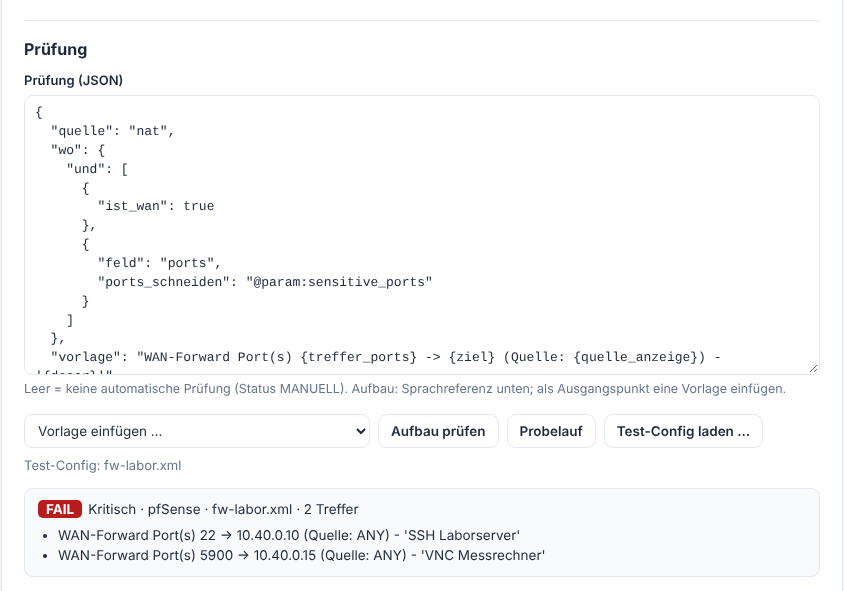

[Deutsch](README.de.md) · **English**

# Firewall-Validation Portable

A portable security auditor for **OPNsense** and **pfSense** firewalls — entirely client-side: no server, no installation, no data transfer.

The tool checks a firewall configuration (`config.xml`) that you export yourself against a quantified rule catalog (34 rules, 6 categories), calculates a **posture score (0–100)** and a **grade (A–F)** from it, and produces a readable audit report with reasoning, recommended measure and references for every finding. When several configurations are loaded, a **fleet dashboard** for fleet analysis appears as well.



<sub>All screenshots show fictitious example configurations (addresses from documentation and private ranges). **The tool's interface is in German**; German labels are shown in quotation marks or italics with an English translation. More views: [Detailed findings](#audit-single-configuration), [Fleet dashboard](#fleet-dashboard-multiple-configurations), [Rule editor](#editing-the-rule-catalog-rules-editorhtml).</sub>

## Features

### Audit (single configuration)
- **Automatic platform detection** — OPNsense and pfSense (CE), based on the XML root element; platform-specific check paths (e.g. OPNsense nested config, pfSense IDS packages Suricata/Snort).
- **34 rules in 6 categories:**

  | Category (German name in the UI) | Rules (examples) |
  |---|---|
  | Management plane (*Management-Ebene*) (8) | WebGUI/SSH reachable from WAN, HTTP instead of HTTPS, root login, SSH password authentication, MFA/OTP for admins, root account, console menu |
  | Firewall rules (*Firewall-Regeln*) (9) | Shadowed rules caused by wrong ordering (block and pass rules behind a catch-all rule), any→any pass rules, WAN exposure, “Block private/bogon networks”, typo netmasks (host IP with /24), disabled rules, block without logging |
  | NAT / port forwarding (4) | Forwarding of sensitive ports (SSH, RDP, SMB, databases, VNC, Redis, ES, MongoDB …), source ANY, UPnP/NAT-PMP, 1:1 NAT |
  | Service exposure (*Dienst-Exposition*) (5) | SNMP default community, Unbound open-resolver risk, open NTP, IDS/IPS disabled, IDS without blocking mode |
  | VPN (4) | IPsec IKEv1/aggressive mode, OpenVPN without AEAD cipher, unrestricted VPN access (ANY), WireGuard allowed-IPs review |
  | System hardening (*System-Härtung*) (4) | Firmware status (live-check note), remote syslog, API keys, secrets in config.xml |

- **Status per rule:** `FAIL` (vulnerability), `WARN` (conditional risk), `OK` (fulfilled), `N/A` (not applicable), `MANUELL` (manual: live check required), `FEHLER` (error while running the check).
- **Detailed report** per rule with findings (concrete rule numbers, ports, accounts), reasoning, recommended measure and references.
- **Filters** in the report: Open (FAIL+WARN), FAIL only, WARN only, Passed, Manual, N/A, All.
- **Alias resolution:** Host and port aliases (including nested aliases) are resolved and included in port and destination checks.



### Fleet dashboard (multiple configurations)
- **KPIs:** average and median posture score, number of devices, devices needing action (grade below B), devices with critical/high findings, total open findings.
- **Distributions:** grade distribution (A–F) and score histogram (10-point buckets).
- **Systemic findings:** the most frequent FAIL/WARN rules across the fleet, with drill-down (“which sites have this finding?”).
- **Category view:** sites with FAIL per category.
- **Site table:** sortable and searchable, filterable by grade, platform, “critical only” and “needs action”, with pagination; clicking a device opens its single report with a way back to the dashboard.



### Usage & technology
- **Drag & drop** or file selection; several files = fleet mode.
- **100 % client-side:** the XML is parsed in the browser with `DOMParser` — no uploads, no backend, usable offline (also via `file://`).
- **Print-optimized** (print stylesheet; filters hidden, sections not broken across pages).
- **Responsive** layout (desktop + mobile).

## Scoring model

Every rule has a severity with a weight:

| Severity (German name in the UI) | Weight |
|---|---|
| critical (*kritisch*) | 10 |
| high (*hoch*) | 6 |
| medium (*mittel*) | 3 |
| low (*niedrig*) | 1 |
| info | 0 |

Calculation:

```
Penalty  = Σ (weight × factor)   with FAIL = 1.0, WARN = 0.5, OK = 0.0
Posture  = 100 × (1 − Penalty / max. possible penalty)
Grade    = A ≥ 90, B ≥ 80, C ≥ 70, D ≥ 60, otherwise F
```

`N/A` and `MANUELL` are **not** included in the denominator — the score is therefore normalized only over rules that can actually be evaluated.

## Requirements

- **A modern web browser** with JavaScript enabled (ES2017+: `async/await`, `DOMParser`, `Set`, `Object.assign`). Firefox, Chrome/Chromium, Edge and Safari (current versions) are supported.
- **These files must be in the same directory:**
  - `index.html` — display: upload, single report, fleet dashboard
  - `engine.js` — check logic: read the XML, run the rule language, scoring
  - `rules.js` — rule catalog and settings (loaded via `<script>` tag as `window.RULES_DATA`)
  - `rules-editor.html` — optional editor for the rule catalog (see below)
  - `tests/` — optional: self-test of the check engine and reference configs (see below)
  - `LICENSE` — license text (GNU GPL version 3); `NOTICE` — copyright notice and additional term under section 7(b) (see [License](#license))
  - `site/` and `.github/workflows/pages.yml` — project page for GitHub Pages (see [Project page](#project-page-on-github-pages)); not needed to run the tool
  - `docs/screenshots/` — images of this README; not needed to run the tool
  - `README.de.md` — German version of this README (this file is `README.md`)
  - `HANDBUCH.html` / `HANDBUCH.pdf` — detailed user manual (in German) for `index.html` and the rule editor with annotated screenshots (the HTML version is self-contained, images embedded; the PDF is the same version for printing)
- **No web server, no build, no further dependencies** — opening `index.html` directly from the file system (`file://`) works just as well as hosting on any static server or forge (GitHub Pages, Codeberg Pages).
- **The `config.xml` to be checked is NOT part of this repository.** You export it yourself from your firewall (any number of devices):
  - OPNsense: *System → Configuration → Backups → Download*
  - pfSense: *Diagnostics → Backup & Restore*

## Usage



1. Open `index.html` in the browser (a double-click is enough).
2. Drop the `config.xml` exported from the firewall onto the page, or load it with “Select file” (*Datei auswählen*). The file is read only locally in the browser.
   - One file → single report with scorecard, overview table and detailed findings.
   - Several files → fleet dashboard with aggregation; clicking a device shows its single report.
3. Print the report (Ctrl+P) or filter it as needed.

## Structure: data model, logic and display

Since catalog 1.2.0, *what* is checked is also part of the data model:

| File | Role | Contains |
|---|---|---|
| `rules.js` | Data model | Rules with texts, severity, active/inactive, parameters **and check definition** (field `check`), plus global settings (weights, penalty factors, WAN interfaces) |
| `engine.js` | Logic | Fact layer (translates the `config.xml` per platform into uniform objects), interpreter of the rule language, 4 building blocks in program code, scoring. No display. |
| `index.html` | Display | File upload, single report, fleet dashboard. No check logic. |
| `rules-editor.html` | Maintenance | Edits `rules.js` including the checks; structure check and test run via `engine.js` |

For each audit, the engine runs through every active rule of the catalog and executes its check definition. The result (status, findings, possibly a deviating severity) is combined with the weight and penalty factor from `rules.js`. 30 of the 34 rules consist of data only; 4 call a **building block** (*Baustein*), because their logic (deriving the port from the config, interlinked user lists, netmask arithmetic) would exceed the scope of the rule language: `MGMT-WEBGUI-WAN`, `MGMT-SSH-WAN`, `MGMT-ROOT-ACCOUNT`, `FW-HOST-CIDR`.

**Effective settings from `rules.js`** (if a value is missing or invalid, the default applies):

| Setting | Effect | Default |
|---|---|---|
| `meta.severity_weights` | Weight per severity | 10 / 6 / 3 / 1 / 0 |
| `meta.scoring.penalty_fail/warn/pass` | Share of the weight that counts as penalty points | 1.0 / 0.5 / 0.0 |
| `meta.wan_interfaces` | Interfaces treated as the internet side (all WAN checks) | `["wan"]` |
| `NAT-MGMT-EXPOSED` → `params.sensitive_ports` | Ports whose WAN forwarding counts as sensitive | 22, 23, 135, 139, 445, 1433, 3306, 3389, 5432, 5900, 5901, 6379, 9200, 11211, 27017 |
| `SVC-SNMP-PUBLIC` → `params.default_communities` | SNMP communities considered insecure | public, private |
| `FW-ANY-ANY` → `params.wan_zone_severity` | Severity of an any-any rule on WAN | high |

Further check values (e.g. NTP port 123, cipher lists, XML paths) are stored directly in the respective check definition and can therefore also be changed in the editor. Custom rules can define their own parameters and use them in the check with `"@param:name"`.

## Editing the rule catalog (`rules-editor.html`)

Like `index.html`, the editor is fully usable offline (`file://`, no dependencies) and automatically loads the `rules.js` from the same folder. Alternatively, “Open rules.js …” (*rules.js öffnen …*) loads any other catalog file (including a plain `rules.json`).



- **View & search:** Rules grouped by category, color bar = severity, disabled rules struck through; search by ID, title and category.
- **Edit:** Title, category, severity, active/inactive, reasoning, measure, references (one per line) and optional parameters (JSON). “Apply” (*Übernehmen*) writes the change into the catalog; changed and new rules are marked in the list.
- **New rules / delete:** New rules are inserted at the end of their category. IDs are checked for format and uniqueness.
- **Catalog settings:** Name, description, weights per severity, penalty factors and the WAN interfaces (e.g. `wan, opt2` with two providers).
- **Parameters:** For every rule the editor shows which parameters the engine actually reads (hard-wired ones as well as those used in the check via `@param:`). The hard-wired ones are validated before applying.
- **Check:** The check definition of each rule as JSON. “Insert template …” (*Vorlage einfügen …*) offers a starting point for every check type, “Check structure” (*Aufbau prüfen*) reports typos and structural errors with the exact location, and the collapsible **language reference** (*Sprachreferenz*) lists all sources, fields and operators (generated directly from `engine.js`). **“Test run”** (*Probelauf*) executes the check — even unsaved — against a loaded `config.xml` and shows status, hits and findings.

  

- **Rules without a check** are marked “no check” (*ohne Prüfung*) in the list; they appear in the report as `MANUELL`.
- **Save as new version:** The dialog shows what changed compared to the loaded state, suggests a version number (minor for new/removed rules, changed weighting or changed check, otherwise patch) and writes an entry to `meta.changelog`. A new `rules.js` is downloaded — place it next to `index.html` and replace the old one. Optionally, the same state can be exported as `rules.json` for the Python audit tool. The Python tool does not currently evaluate the `check` field; new rules appear there as `MANUAL`.

> **Note on older catalogs:** Catalogs before 1.2.0 contain no check definitions. With the current `engine.js`, only the 4 building blocks are evaluated there; all other rules appear as `MANUELL`. Always use the supplied `rules.js` 1.2.0 (or newer).

## Writing your own checks (rule language)

A check is a JSON object in the `check` field of a rule. The editor lists all sources, fields and operators under “Language reference” (*Sprachreferenz*); here is the principle. The keywords of the rule language are German; they are kept as they are and explained below.

**Three types:**

| `typ` | Purpose |
|---|---|
| `abfrage` (query; default, may be omitted) | Read values from the config and/or filter entries, then evaluate result cases |
| `reihenfolge` (order) | Find pairs where a rule A comes before a rule B (same group, e.g. interface and direction) |
| `baustein` (building block) | Call a check implemented in program code: `{"typ": "baustein", "name": "MGMT-WEBGUI-WAN"}` |

**Parts of a query:**

- `werte` (values) – named values from the config: `{"pfad": "system/webgui/protocol", "standard": "https", "klein": true}` (`pfad` = path, `standard` = default, `klein` = compare in lower case), `{"anzahl": "OPNsense/Syslog/destinations/destination"}` (`anzahl` = count) or `{"verbinde": ["syslog/remoteserver", "syslog/remoteserver2"]}` (`verbinde` = join). Paths may differ per platform: `{"opnsense": "…", "pfsense": "…"}`.
- `quelle` + `wo` + `vorlage` (source + where + template) – filter entries of a fact source (`filterregeln`, `nat`, `benutzer`, `interfaces`, `wan_interfaces`, `ids_instanzen`) and build a text per hit. Instead of `quelle`, `xml` with an XML path also works (`a/b/c`, `a/*` for all children, `//name` for the first occurrence anywhere). Several queries: `abfragen: [ … ]`, each optionally with `plattform` (platform).
- `ergebnis` (result) – list of cases, **the first matching one applies**; the last case without `wenn` (if) is the default. A case has `status` (FAIL, WARN, PASS, NA, MANUAL), optionally `schweregrad` (severity), `befund` (one text) or `befunde: "je_treffer"` (one finding per hit) and `notiz` (note).

**Conditions** (in `wo` and `wenn`): short form `{"aktiv": true, "aktion": ["block", "reject"]}` (all fields must match, a list means “one of them”), operators via `{"feld": "ziel_port", "port_ist": ["123"]}`, combinations `und` / `oder` / `nicht` (and / or / not), switches and paths `eingeschaltet` / `existiert` (enabled / exists), quantifiers `eine` / `keine` (one / none; a subquery), `treffer_mit`, and, as the value of `wenn`, the words `"treffer"`, `"keine_treffer"` and `"quellen_leer"` (hits / no hits / sources empty). Texts are compared case-insensitively.

**Text templates:** `{field}`, `{field|fallback if empty}`, `{field:klein}` (lower case), `{?field=text only if the field is true}`, `{liste}` (all hit texts, separated by commas), and for order checks `{vorher.nr}` and `{nachher.descr}` (the rule that comes before and the one that comes after).

**Example 1 – your own rule:** SSH exposure on WAN (ports as a parameter of the rule, `"params": {"ports": ["22", "2222"]}`):

```json
{
  "quelle": "filterregeln",
  "wo": {"und": [{"aktiv": true, "aktion": "pass", "ist_wan": true},
                 {"feld": "ziel_port", "port_ist": ["@param:ports"]}]},
  "vorlage": "#{nr} [{interface}] {quelle_anzeige} -> {ziel_text} - '{descr}'",
  "ergebnis": [
    {"wenn": "treffer", "status": "WARN", "befunde": "je_treffer"},
    {"status": "PASS"}
  ]
}
```

**Example 2 – adding a storage location:** If the test plan shows that a setting lives elsewhere in your version, it is enough to add the path – e.g. for SNMP `"community": {"pfad": ["snmpd/rocommunity", "OPNsense/netsnmp/general/community"]}`. You can check it immediately with “Test run” against the export in question.

**Limits:** New fact sources (e.g. rules from *Firewall → Automation*), new operators or new building blocks require an extension of `engine.js`. The language is deliberately kept small: no variables, no loops.

### Corrections compared to catalog 1.1.0

- `SVC-DNS-OPENRESOLVER` (pfSense): An interface list such as `lan,opt2,wan` is now evaluated completely. Previously only the first comma was taken into account and `wan` was overlooked in such lists.
- Text comparisons are now case-insensitive throughout. This only changes results for unusual spellings (e.g. `IKEv1` instead of `ikev1`).
- New rules `FW-SHADOWED-BLOCK` and `FW-SHADOWED-PASS`. Since they also raise the maximum possible penalty, scores may shift slightly — in both directions.

## Self-test (`tests/selbsttest.html`)

Open `tests/selbsttest.html` in the browser. The page evaluates ten synthetic test configs (OPNsense and pfSense, each “weak”, “hardened”, “minimal”, variants and cases for rule ordering) with `engine.js` and compares all 340 individual results with a stored reference. It uses its own frozen copy of the catalog (`tests/katalog-referenz.js`), so changes to `rules.js` do not affect the test.

- **Run it after every change to `engine.js`.** Expected: “Alle 340 Ergebnisse stimmen mit der Referenz überein” (all 340 results match the reference).
- A deviation is not necessarily a bug: if the check logic was changed on purpose, the reference has to be regenerated.
- The test configs are also included as `tests/configs/*.xml` and can be loaded directly into `index.html`.

A test plan for checking with real firewall configurations (in German) is in `TESTPLAN.md`.

## Security note

The `config.xml` contains **password hashes, VPN keys and possibly PSKs**. `rules.js` and `engine.js` are loaded via `<script>` and thus executed as program code – check catalog files from unknown sources before use. Since the tool works exclusively client-side, the configuration does not leave the computer — still, the following applies: run audits offline where possible, store outputs and backups encrypted and restrict access.

An automated audit does not replace a manual review (rules with status `MANUELL` require a live check on the appliance).

## Project page on GitHub Pages

The `site/` folder contains a project page that presents the tool. The workflow `.github/workflows/pages.yml` publishes on every push to `main`:

| Address | Content |
|---|---|
| `https://<user>.github.io/<repository>/` | Project page |
| `…/app/` | the tool itself as a demo, with the example configs under `app/tests/configs/` |
| `…/HANDBUCH.html`, `…/HANDBUCH.pdf` | User manual (in German) |

One-time setup: in the repository under *Settings › Pages*, choose “GitHub Actions” as *Source*. The workflow inserts the links to the repository and the ZIP download itself; the page takes the number of rules and categories from the co-published `rules.js`.

Like the local version, the demo runs entirely in the browser. For real configurations, the downloaded version on a computer without a network connection is still recommended.

## License

Copyright (C) 2026 Christian Jelitte

Firewall-Validation Portable is free software under the **GNU General Public License, version 3 or later** (`GPL-3.0-or-later`). The full license text is in [`LICENSE`](LICENSE).

**Additional term (attribution).** Under section 7(b) of the GPLv3, the following also applies: The notice “Firewall-Validation Portable - Copyright (C) 2026 Christian Jelitte” must be preserved in all copies and modified versions, namely in the file headers and in the visible license notice at the bottom of `index.html` and `rules-editor.html`. The binding wording is in [`NOTICE`](NOTICE).

What this means in practice:

- You may use, share and modify the tool, also commercially.
- Redistributions and modified versions remain under GPL-3.0-or-later and are passed on with source code.
- The copyright notice is preserved; modified versions are marked as modified (section 5(a) of the GPL).
- When saving a new `rules.js`, the rule editor automatically writes the license header, and `meta.copyright` is also preserved in the JSON export.

The project page uses the typeface Atkinson Hyperlegible under the SIL Open Font License 1.1 (`site/fonts/OFL-*.txt`).

This program is free software: you can redistribute it and/or modify it under the terms of the GNU General Public License as published by the Free Software Foundation, either version 3 of the License, or (at your option) any later version. This program is distributed in the hope that it will be useful, but WITHOUT ANY WARRANTY; without even the implied warranty of MERCHANTABILITY or FITNESS FOR A PARTICULAR PURPOSE. See the GNU General Public License for more details. Additional term under section 7(b): see [`NOTICE`](NOTICE).
